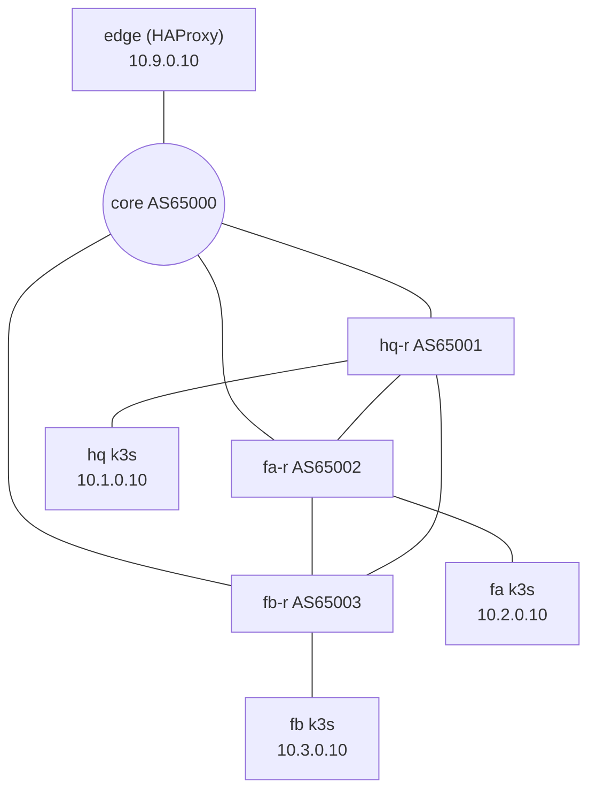
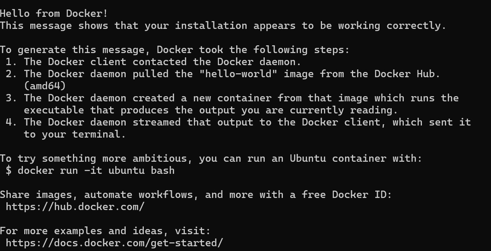
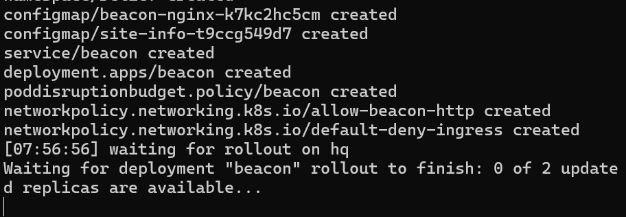
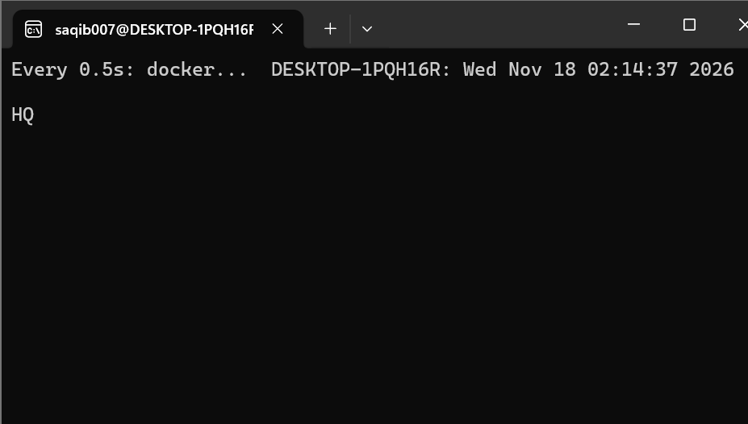
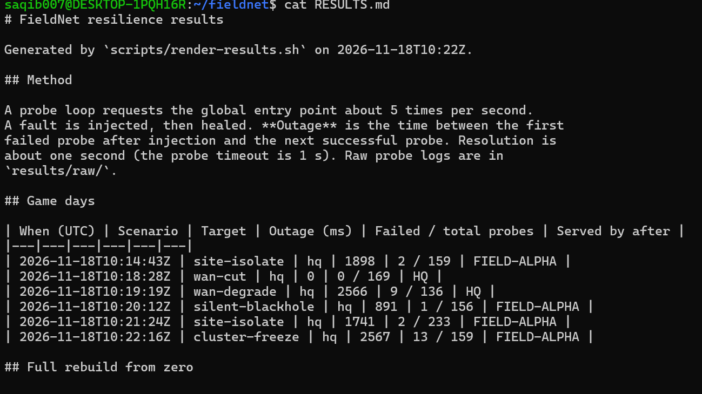

# EliteNet: a self-healing multi-site network for disaster relief

EliteNet is a multi-site platform that is built, broken, and rebuilt entirely
from code. Three sites (a command post and two field clinics) are joined by a
BGP-routed WAN. Each site runs its own Kubernetes cluster. A global entry point
keeps one workload reachable while the network around it is deliberately
destroyed, and the repo **measures** how well it copes.

The story: relief teams deploy to places where links fail. The platform must
keep serving when a site disappears, and a lost site must be rebuilt from a
git checkout, not from someone's memory.

## What makes it different

- **A real network, not just VMs.** FRRouting routers speak eBGP across a core
  and a direct site-to-site triangle, so routes reconverge when links die.
- **Failure is a feature.** `chaos/gameday.sh` cuts links, blackholes traffic,
  adds latency and freezes a cluster, then records the user-visible outage.
- **Measured, not claimed.** Results land in [RESULTS.md](RESULTS.md) as a table
  generated from raw probe logs.
- **Timed rebuild.** `make rebuild` destroys everything and reports how long
  the rebuild from zero took.
- **Security as code.** Restricted Pod Security, default-deny NetworkPolicy,
  non-root containers, dropped capabilities, a PodDisruptionBudget.

## Architecture



Details and the full addressing plan: [docs/ARCHITECTURE.md](docs/ARCHITECTURE.md).

## Requirements

- Linux with Docker (a Ubuntu VM is fine; plain Windows is not enough)
- [containerlab](https://containerlab.dev/install/) and `sudo`
- `nsenter` and `tc` on the host (part of `util-linux` and `iproute2`)
- About 6 GB of free RAM and 10 GB of disk (three k3s clusters)

## Quick start

```bash
make up          # network + 3 clusters + workload (first run pulls images)
make status      # BGP sessions, clusters, which site is serving
make chaos SCEN=site-isolate SITE=hq
make rebuild     # destroy everything and rebuild from zero, timed
make destroy
```

### Lite mode (two sites, about 3 GB of RAM)

The repo ships with a `.lite` file, which switches every script to a two-site
version of the lab (HQ + Field Alpha) defined in
`network/fieldnet-lite.clab.yml`. Delete `.lite` to run the full three-site
lab. The design is identical; only Field Bravo is left out.

## Game-day scenarios

| Scenario | What breaks | What it proves |
|---|---|---|
| `wan-cut` | one site's uplink to the core | BGP reroutes via the other sites |
| `wan-degrade` | 250 ms delay + 15% loss | the platform tolerates a bad link |
| `silent-blackhole` | 100% loss, link stays "up" | failure detection by health checks, not link state |
| `site-isolate` | every WAN link of a site | global failover to a surviving site |
| `cluster-freeze` | the site's Kubernetes node | app-level failover, network unaffected |

## Repository layout

```
network/    containerlab topology, FRR configs, HAProxy entry point
apps/       Kubernetes manifests (kustomize base + one overlay per site)
scripts/    up / deploy / status / rebuild / destroy
chaos/      game-day fault injection and scoring
docs/       architecture, design decisions, runbook, defense prep
RESULTS.md  generated measurements
```

## Assignment mapping

| Requirement | Where |
|---|---|
| Multi-site | three sites plus a core, `network/fieldnet.clab.yml` |
| Resilient network | eBGP over a core and a triangle, `network/frr/` |
| Kubernetes platform | one k3s cluster per site, `apps/` |
| Highly available | HAProxy health-checked failover, 2 replicas, PDB |
| Fully automated | `make up`, no manual steps |
| Rebuilt from code | `make rebuild`, timed |

## Known limits (honest list)

- The workload is stateless. Replicated state (for example CloudNativePG) is
  the natural next step; RPO is therefore not measured yet.
- Sites run a single-node k3s each, so node loss inside a site is a full
  cluster loss. That is why `cluster-freeze` behaves like a site failure.
- Failover is decided at the entry point; there is no DNS-level global load
  balancer.
- Measurements have roughly one-second resolution.

## Authorship and AI use

Parts of this project were produced with an AI assistant and then reviewed,
run and adapted by the author. Disclose this according to your course policy.

## Demo screenshots

Failover test: HQ site isolated, traffic moves to Field Alpha.

**1. The lab running in Docker: routers, two Kubernetes clusters and the entry point.**



**2. Game-day output: the measured outage and failed probes.**



**3. The HQ site serving traffic.**



**4. The Relief Beacon web page served by the platform.**



